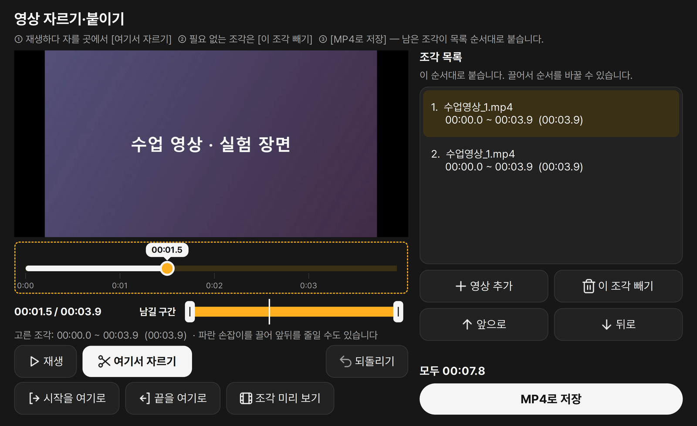

  

<h1 align="center">Plopp</h1>

  <b>끌다가 Q, 놓으면 퐁.</b> 
  파일 변환 · 화질 지키는 용량 줄이기 · PDF 편집 · 화면 녹화 · 영상 자르기를 끌어다 놓기 한 번으로 끝내는 무료 Windows 앱

  <a href="https://plopp-sh.vercel.app/download"><b>⬇ Windows용 다운로드</b></a>
  ·
  <a href="https://plopp-sh.vercel.app">소개 사이트</a>
  ·
  <a href="https://github.com/akaz01/educonverter/releases">모든 버전</a>

> 예전 이름은 **EDU_Converter**예요. 선생님뿐 아니라 정말 많은 분들이 관심을 보내 주셔서, 누구나 쓰기 좋게 이름을 Plopp으로 바꾸고 기능을 늘렸어요.

## 쓰는 법
1. 탐색기나 바탕화면에서 파일을 **끌기 시작**해요.
2. 끄는 중에 **Q** 키를 누르면 커서 주변에 동그란 메뉴가 펼쳐져요. 마우스는 놓지 마세요.
3. 원하는 칸이 밝게 켜지면 **놓아요. 퐁!** 원본은 그대로 두고, 원본 옆에 새 파일이 생겨요. 여러 파일도 한꺼번에 돼요.

모든 변환은 내 컴퓨터 안에서만 이루어져요. 파일을 인터넷에 올리지 않아요.

## 할 수 있는 것
| 칸 | 넣을 수 있는 파일 | 결과 |
|---|---|---|
| **PDF** | 이미지(여러 장은 한 파일로), 한글, Word, Excel, PPT | PDF |
| **Image** ••• | 이미지, PDF, 한글, Office 문서 | JPG·PNG·WEBP·BMP, 긴 이미지 한 장 |
| **HWP** ••• | PDF, 한글, Word | HWP·HWPX |
| **Word** | PDF, 한글 | DOCX |
| **Excel** | PDF, 한글, Word, PPT | XLSX (표를 찾아 시트로) |
| **PPT** | PDF, 한글, Word, Excel | PPTX (쪽마다 슬라이드) |
| **Text** ••• | PDF, 한글, Office 문서 | TXT·HTML |
| **Edit** ••• | PDF, 영상 | PDF 쪽 편집 창 · 영상 자르기·붙이기 창 |
| **Size** ••• | 이미지, PDF, 한글 | 같은 형식, 더 작은 파일 |

••• 표시 칸은 놓은 뒤 한 번 더 골라요.

- **화질 지키는 용량 줄이기 (Size)**: 원본과 화질을 비교해 기준을 넘을 때만 줄여요. 한글 문서는 글자·표·서식은 그대로 두고 안에 든 그림만 줄여요.
- **PDF 쪽 편집 (Edit)**: 쪽을 끌어 순서를 바꾸고, 지우고, 돌린 뒤 새 파일로 저장해요. 실수해도 `Ctrl` + `Z`.
- **화면 캡처**: `Alt` + `` ` ``(Esc 아래 키)로 영역을 고르면 바로 클립보드에 복사돼요.

## 새로워진 것
- **화면 녹화**: `Alt` + `Shift` + `` ` ``로 영역을 골라 바로 녹화해요. 컴퓨터 소리와 마이크도 함께 담고, [정지]를 누르면 MP4로 저장돼요.
- **영상 자르기·붙이기**: 필요한 부분만 남기고 여러 영상을 이어 붙여 MP4로 저장해요. Edit 칸에 영상을 놓거나 시작 창에서 열어요.
- **블랙·화이트 테마**: 설정에서 한 번에 바꿔요. 창과 변환 메뉴가 함께 바뀌어요.
- **한국어 / English**: 설치할 때 언어를 고르고, 나중에 설정에서 언제든 바꿀 수 있어요.
- **Size 2차 선택**: Size 칸에 놓으면 **가장 작게 · 균형 · 고화질** 중에 골라요.

## 설치
1. [최신 버전](https://plopp-sh.vercel.app/download)을 받아 **zip 압축을 풀어요.**
2. 폴더 안의 `Plopp.exe`를 실행하면 설치 창이 떠요. 맨 위에서 **한국어 / ENGLISH**를 고르고 [설치]를 눌러요. **관리자 권한은 필요 없어요.**
3. 오른쪽 아래 트레이에 검은 Plopp 아이콘이 생기면 준비 끝.

- **업데이트**: 새 zip의 `Plopp.exe`를 실행하고 [업데이트]를 누르면 돼요. 지울 필요 없이 덮어쓰고, 설정은 그대로예요.
- **EDU_Converter를 쓰고 계셨다면**: 그대로 Plopp을 설치하면 돼요. 쓰던 설정은 이어지고, 예전 EDU_Converter는 자동으로 정리돼요.

## 필요한 것
- Windows 10/11 (관리자 권한 필요 없음)
- PDF·Word를 한글로 바꿀 때: 한컴오피스 한글
- Word·Excel·PPT 관련 변환: MS Office
- 열어 둔 한글·Office 창은 건드리지 않고, 직접 놓은 파일만 열어요.
- 관리자 권한으로 실행한 창 위에서는 Q가 안 돼요. 이럴 때는 트레이 아이콘 우클릭 → **변환 메뉴 열기 (고정)**.
- 새 버전 알림: 하루 한 번 최신 버전 번호만 확인해요(소개 사이트의 `/api/latest`만). 개인정보는 보내지 않고, 설치는 직접 하실 때만 돼요. 설정에서 끌 수 있어요.

## 라이선스
[AGPL-3.0](https://www.gnu.org/licenses/agpl-3.0.html) · © 2026 이수훈

만든 사람: 이수훈 · akazhoon@gmail.com
불편한 점이나 바라는 기능은 [Issues](https://github.com/akaz01/educonverter/issues)나 메일로 편하게 알려 주세요.

이 저장소에는 소개 사이트와 설명이 있고, 프로그램은 [Releases](https://github.com/akaz01/educonverter/releases)에서 받을 수 있어요.
