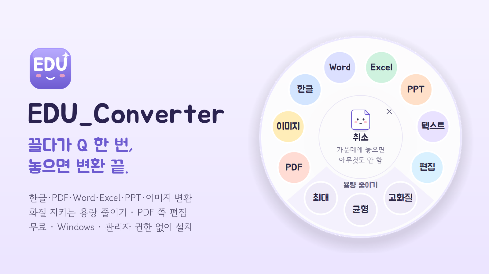
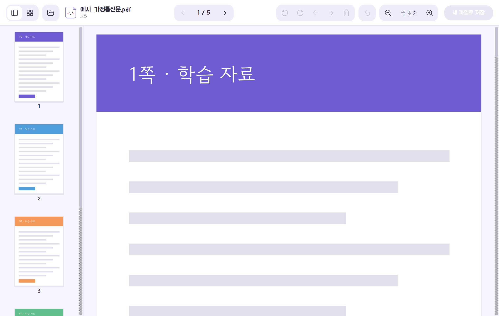

  

<h1 align="center">EDU_Converter</h1>

  <b>끌다가 Q 한 번, 놓으면 변환 끝.</b> 
  한글·PDF·Word·Excel·PPT·이미지 변환과 화질 지키는 용량 줄이기를 한 번에 하는 선생님용 Windows 앱

  <a href="https://github.com/akaz01/educonverter/releases/latest/download/EDU_Converter_win.zip"><b>⬇ Windows용 다운로드</b></a>
  ·
  <a href="https://educonverter.vercel.app">소개 사이트</a>
  ·
  <a href="https://github.com/akaz01/educonverter/releases">모든 버전</a>

## 쓰는 법
1. 탐색기나 바탕화면에서 파일을 **끌기 시작**합니다.
2. 끄는 중에 **Q** 키를 누르면 커서 주변에 동그란 메뉴가 펼쳐집니다.
3. 원하는 칸까지 끌고 가서 **놓으면 끝**. 원본은 그대로, 원본 옆에 새 파일이 생깁니다.

## 할 수 있는 것
| 칸 | 넣을 수 있는 파일 | 결과 |
|---|---|---|
| PDF | 이미지(여러 장은 한 파일로), 한글, Word, Excel, PPT | PDF |
| 이미지 | 이미지, PDF, 한글, Office 문서 | JPG·PNG·WEBP·BMP, 긴 이미지 한 장 |
| 한글 | PDF, 한글, Word | HWP·HWPX |
| Word | PDF, 한글 | DOCX |
| Excel | PDF, 한글, Word, PPT | XLSX (표를 찾아 시트로) |
| PPT | PDF, 한글, Word, Excel | PPTX (쪽마다 슬라이드) |
| 텍스트 | PDF, 한글, Office 문서 | TXT·HTML |
| 용량 줄이기 | 이미지, PDF, 한글 | 같은 형식, 더 작은 파일 |

- **화질 지키는 용량 줄이기**: 원본과 화질 유사도를 비교해 기준을 넘을 때만 압축(고화질·균형·최대). 한글 문서는 안에 든 그림만 줄입니다.
- **PDF 보기·편집**: 쪽 순서 바꾸기·삭제·회전 후 새 파일로 저장

- **화면 캡처**: `Alt` + `` ` ``(Esc 아래 키)로 영역을 잡으면 바로 클립보드에 복사

## 설치
1. [최신 zip](https://github.com/akaz01/educonverter/releases/latest/download/EDU_Converter_win.zip)을 받아 **압축을 풉니다.**
2. 폴더 안의 `EDU_Converter.exe`를 실행하면 설치 창이 뜹니다. **관리자 권한이 필요 없습니다.**
3. 오른쪽 아래 트레이에 보라색 EDU 아이콘이 생기면 준비 끝.

새 판은 새 zip의 exe만 실행하면 설정은 그대로 두고 업데이트됩니다.

## 필요한 것
- Windows 10/11
- 한글 관련 변환: 한컴오피스 한글 / Word·Excel·PPT 관련 변환: MS Office
- 열어 둔 한글·Office 창은 건드리지 않고, 직접 놓은 파일만 엽니다.

## 만든 사람
이수훈 · akazhoon@gmail.com — 불편한 점이나 바라는 기능은 [Issues](https://github.com/akaz01/educonverter/issues)나 메일로 알려 주세요.

© 2026 이수훈. 이 저장소에는 소개 사이트와 설명만 있고, 프로그램은 [Releases](https://github.com/akaz01/educonverter/releases)에서 받을 수 있습니다.
